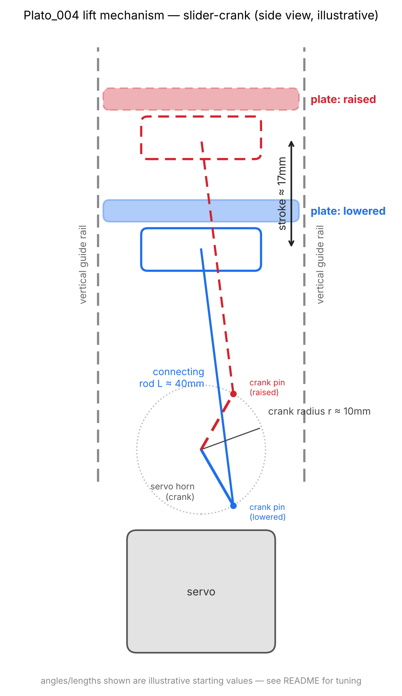
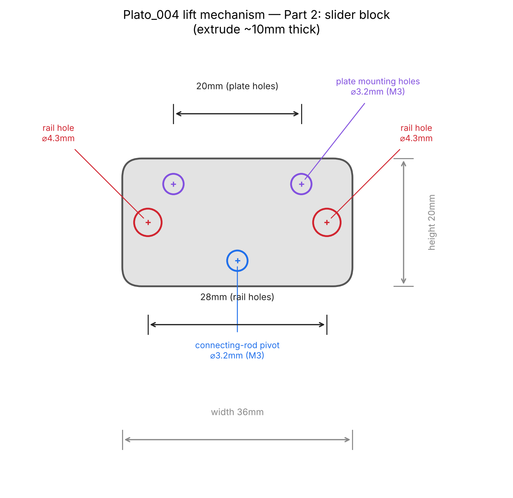
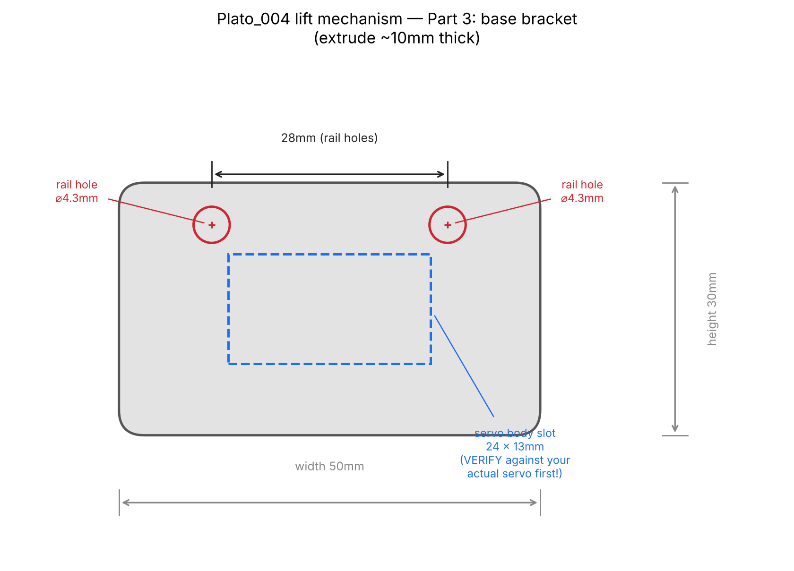
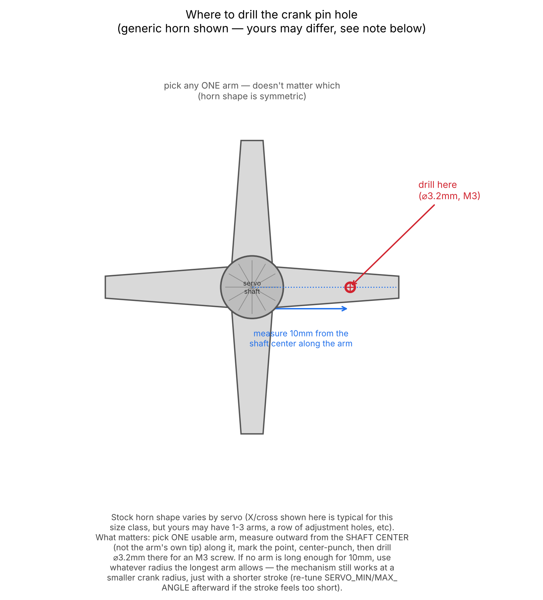

# Plato_004_fsr_led_buzzer_vibration_lift (Seeeduino XIAO, SAMD21)

Extends `Plato_002_fsr_led_buzzer_vibration` with a fourth output: a
servo-driven **slider-crank mechanism** that physically lifts and lowers
the resonance plate while pressed, instead of only buzzing/vibrating it.
FSR→LED brightness, the buzzer's chirp pattern, and the vibration motor's
force-proportional intensity are all unchanged — see
`Plato_002_fsr_led_buzzer_vibration/README.md` for the reasoning behind
each of those. This README only covers the new lift layer.

## Full build order (checklist)

Start the 3D prints first (they take hours) and do the rest while they run.

**0. Kick off prints**
- [ ] Print the 3 parts from `hardware/cad/plato_004_lift_parts.dxf`
      (connecting rod, slider block, base bracket) — see "How to build
      the mechanism" below for extrusion thickness per part.

**1. Breadboard wiring** (can do while prints run — see "Wiring" below and
`Plato_001_fsr_led`/`Plato_002_fsr_led_buzzer_vibration`'s READMEs for the
rows this builds on)
- [ ] FSR402 + LED (`Plato_001` base): `A0` ← FSR divider, `D9` → 330Ω →
      LED → GND
- [ ] Buzzer (`Plato_002` addition): `D8` ↔ buzzer `-` (long) lead, XIAO
      `5V` → buzzer `+` (short) lead
- [ ] Vibration motor (`Plato_002` addition): `D2` → `IN`, `3V3` → `VCC`,
      `GND` → `GND`
- [ ] Servo (this build's addition): `D1` → signal, XIAO `5V` → power
      (red), `GND` → ground (brown)

**2. Firmware**
- [ ] Confirm the `Servo` library is installed (Library Manager → "Servo"
      by Arduino — usually bundled already)
- [ ] Open `Plato_004_fsr_led_buzzer_vibration_lift.ino`, board = Seeed
      SAMD Boards > Seeeduino XIAO, upload
- [ ] Open Serial Monitor @ 9600 baud, press the FSR, confirm
      `raw`/`conductance`/`brightness`/`pressed` respond sensibly (same
      calibration check as `Plato_001`)

**3. Mechanical assembly** (once prints finish — full detail in "How to
build the mechanism" below)
- [ ] Drill the crank pin hole into the stock servo horn (~10mm radius)
- [ ] With the firmware already running (servo sitting at
      `SERVO_MIN_ANGLE`), press the drilled horn onto the servo spline
      *now*, then lock its retaining screw — this is what makes the
      physical "lowered" position match the firmware's
- [ ] Seat the 2 guide rods into the base bracket
- [ ] Slide the slider block onto the rails — confirm free vertical
      movement, no binding/wobble, before going further
- [ ] Connect the linkage: rod eyelet → crank pin, rod eyelet → slider
      pivot, both loose/free-pivoting
- [ ] Mount the servo body into the base bracket's slot
- [ ] Run several press cycles **with no plate attached** — watch for
      binding or the rod popping off a pivot
- [ ] Attach the resonance plate to the slider's mounting holes

**4. Final test**
- [ ] Light press → LED dims, vibration motor barely kicks in, buzzer
      chirps softly, lift moves slowly
- [ ] Hard press → all four outputs scale up together
- [ ] If anything binds, feels too weak, or feels jerky, see the tuning
      notes in each relevant section below (LED/FSR calibration in
      `Plato_001`, buzzer/vibration tuning in `Plato_002`, lift tuning
      further down this file)

## Why a slider-crank, and why it works with only a servo

The only actuator available for this (`SFE-ROB-14760`) is a hobby **servo**,
not a continuous-rotation motor — it sweeps across a limited arc (rated
~160°), it doesn't spin all the way around. That's not actually a problem
for "rotary motion → up/down motion": a slider-crank (the same mechanism
that converts a piston engine's crank rotation into linear motion) only
needs its crank pin to sweep through *some* arc to make the slider
reciprocate once per sweep — full 360° rotation was never required, just
like a windshield-wiper linkage.

```
        servo horn (crank)
             o────┐
            /      \  crank pin (off-center, ~10mm radius)
    servo  ⊙        \
   shaft            ◇ ── connecting rod (~40mm) ── [slider] ↕ (vertical guide)
                                                        │
                                                   resonance plate
```



- **Servo horn = crank.** A pin/screw mounted off-center on the horn
  (crank radius — start around **10mm**) traces an arc as the servo sweeps
  between `SERVO_MIN_ANGLE` and `SERVO_MAX_ANGLE`.
- **Connecting rod** (start around **40mm**, roughly 3-4× the crank
  radius so it doesn't bind near the sweep limits) links that pin to the
  slider with simple pin joints at both ends.
- **The slider must be constrained to vertical-only motion by its own
  guide** — two vertical printed rails/rods through sleeves on the
  slider, or a drawer-slide. The guide is what keeps the slider from
  swinging sideways with the crank; the connecting rod only needs to pivot
  freely at both ends.
- **The resonance plate sits on/attaches to the slider.**

Start with `SERVO_MIN_ANGLE`/`SERVO_MAX_ANGLE` narrower than the servo's
full range (default **20°–140°**, inside its ~160° rated travel) so the
linkage never slams into its own mechanical end stops. Widen gradually
once the real geometry (rod length, pin placement, guide friction) is
tuned on the bench — crank radius, rod length, and the angle range are all
physical-build parameters to dial in by testing, not something to get
exactly right on paper first.

## How to build the mechanism (step-by-step)

Flat profiles for the three custom parts (connecting rod, slider block,
base bracket) are in `hardware/cad/plato_004_lift_parts.dxf` — import via
Fusion 360's Insert > Insert DXF into a sketch, one profile per sketch,
then extrude each to the thickness noted in the DXF (rod ~3-4mm, slider
and base ~10mm) and 3D print flat (no supports needed). The servo horn
itself is **not** in the DXF — it ships with the servo and has a
proprietary spline mount that's easier to drill than to model.

Dimensioned reference diagrams for the two plate-shaped parts (hole sizes
and spacing — the same numbers as the DXF, just easier to read at a
glance than opening Fusion 360):





**Parts/materials beyond what's already in the parts list:**
- 2× smooth guide rods, ~4mm diameter (steel/brass rod is much smoother
  than printed PLA-on-PLA — worth sourcing if the slider feels gritty),
  cut to ~60-70mm (stroke + slider height + mounting margin)
- A few M3 screws + nuts (crank pin, two rod pivots, plate mounting)
- Glue/tape/zip-ties to seat the servo body in its bracket slot

**Assembly order:**

1. **Print the three parts** from the DXF (rod, slider block, base
   bracket).
2. **Drill the crank pin hole.** On one arm of the servo's stock horn,
   mark a point **10mm** from the center shaft hole and drill a 3.2mm
   hole there. Insert an M3 screw through it from underneath and secure
   with a nut on top, snug but still able to spin freely — that screw
   shank is the crank pin the connecting rod will ride on.

   

   Stock horn shapes vary by servo (the X/cross shown is typical for this
   size class, but yours may have fewer/more arms or a row of adjustment
   holes already in it) — pick whichever usable arm you have, and measure
   from the **shaft center**, not the arm's own tip. If no arm is long
   enough for a full 10mm, use whatever radius the longest arm allows;
   the mechanism still works with a smaller crank radius, just a shorter
   stroke (adjust `SERVO_MIN_ANGLE`/`SERVO_MAX_ANGLE` afterward if the
   resulting stroke feels too short).
3. **Zero the horn before locking it on.** Why this matters: a servo
   shaft's spline lets the horn be pressed on at many different
   rotational offsets, so attaching it "blind" means the firmware's idea
   of 20° and the horn's actual physical direction have no fixed
   relationship — worst case, the linkage ends up swinging the wrong way
   or binding against itself. To fix that relationship before it's ever
   ambiguous:
   1. Wire up just the servo (`D1` signal, XIAO `5V` power, `GND`) —
      the horn stays off for now.
   2. Upload a throwaway test sketch that holds the servo at
      `SERVO_MIN_ANGLE` (20°) and does nothing else:
      ```cpp
      #include <Servo.h>
      Servo s;
      void setup() { s.attach(1); s.write(20); }  // D1, SERVO_MIN_ANGLE
      void loop() {}
      ```
      (Uploading the real `Plato_004`/`Plato_005` firmware also works,
      since it starts at `SERVO_MIN_ANGLE` too — the test sketch is just
      simpler to reason about for this one step.)
   3. Power it up and let the servo settle at 20° — it holds that
      position continuously as long as it stays powered and signaled.
   4. **Without powering it off**, press the drilled horn onto the
      spline, oriented so the crank pin points roughly toward where the
      slider will be.
   5. Secure the horn with its retaining screw (comes with the servo)
      while it's still sitting at that position.
   6. From now on, commanding `SERVO_MIN_ANGLE` in firmware returns the
      horn to exactly this physical orientation — the "lowered" position
      is locked in.
4. **Seat the two guide rods** vertically into the base bracket's rail
   holes (press-fit, add a drop of CA glue/epoxy if loose), parallel,
   28mm apart.
5. **Slide the slider block onto the rails.** It should move up/down
   under light finger pressure with no side-to-side wobble or binding —
   if it's tight, slightly ream the rail holes; if it's wobbly, the holes
   are too loose (shim or reprint with tighter clearance).

   
6. **Connect the linkage:** connecting rod's one eyelet over the crank
   pin (secure with a washer + nut loose enough to pivot freely, not
   locked tight), other eyelet over a screw through the slider block's
   pivot hole, same free-pivoting fit at both ends.
7. **Mount the servo body** into the base bracket's servo slot (hot glue
   or double-sided tape for a prototype — the DXF's slot dimensions are
   generic, **measure your actual servo and adjust before cutting**).
8. **Test before attaching the plate.** Upload the firmware and run the
   mechanism empty (no plate) through several full cycles first, watching
   for binding or the rod popping off a pivot — much easier to fix without
   the plate in the way.
9. **Attach the resonance plate** to the slider block's two M3 mounting
   holes once the bare mechanism runs smoothly.

**If it binds or feels wrong:**
- Binding near the sweep extremes → narrow `SERVO_MIN_ANGLE`/
  `SERVO_MAX_ANGLE` in firmware first (cheap to test), or physically ream
  the rail holes if it's friction, not geometry.
- Motion too small → re-drill the horn's crank pin hole slightly farther
  out (bigger radius) and/or widen the angle range.
- Motion feels jerky/mechanical → lower `SERVO_STEP_DEGREES` in firmware
  for smaller, smoother steps.

## Wiring (adds to the Plato_002 breadboard)

Builds on `Plato_002_fsr_led_buzzer_vibration`'s wiring (FSR/LED/buzzer/
vibration rows — see that folder's README):

- `D1` → servo signal wire (yellow/white)
- XIAO `5V` pin → servo power wire (red)
- `GND` → servo ground wire (brown)

**Why the `5V` pin again:** `ROB-14760` is rated **4.8-6V**, the same
reason the buzzer needed the `5V` pin instead of `3V3` — see Plato_002's
README. This needs the board USB-powered (the `5V` pin is a raw USB VBUS
passthrough, not available on battery/3.3V-only power).

**Why the signal wire doesn't need level-shifting:** the servo is powered
at 5V, but its signal/pulse-decoder input still reads the XIAO's 3.3V
logic level as a valid HIGH — practically all hobby servos' decoder ICs
recognize anything above roughly 2-2.5V as HIGH, well below 3.3V. Only the
power wire needs the `5V` pin; the signal wire connects straight to `D1`.

**Why `D1` and not `D6`/`D7`:** the Seeed SAMD core's `Servo` library port
has a known timer conflict with `analogWrite()` specifically on pins 6 and
7 (unrelated to any pin already used in this build, but worth avoiding if
you relocate other outputs later).

## Tuning

- `SERVO_MIN_ANGLE` / `SERVO_MAX_ANGLE` (20 / 140): the plate's lowered/
  raised servo angles. Narrow this range first if the linkage binds or
  the plate doesn't travel smoothly through the whole sweep; widen it
  (towards, but not past, the servo's full ~160° rating) once the
  mechanism is tuned, for a longer stroke.
- `SERVO_STEP_DEGREES` (2): how far the servo moves per internal step —
  larger steps feel jerkier/more mechanical, smaller feel smoother but
  need more steps (and therefore shorter `SERVO_STEP_INTERVAL_*_MS`) to
  reach the same speed.
- `SERVO_STEP_INTERVAL_MIN_MS` / `_MAX_MS` (8 / 30): like the vibration
  motor, lift speed scales with press force — a light press raises/lowers
  slowly, a hard press moves quickly. Lower `_MIN_MS` for a snappier fast
  end; raise `_MAX_MS` for a gentler slow end.

## Setup / build / flash

Same as `Plato_001_fsr_led` — see that folder's README (Seeeduino:samd
board package). This sketch additionally needs the standard Arduino
`Servo` library (Library Manager → "Servo" by Arduino — it's one of the
default libraries bundled with most Arduino IDE installs, not a separate
install in most cases).
